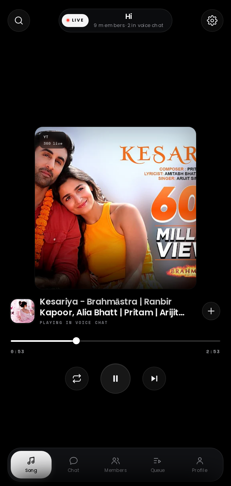
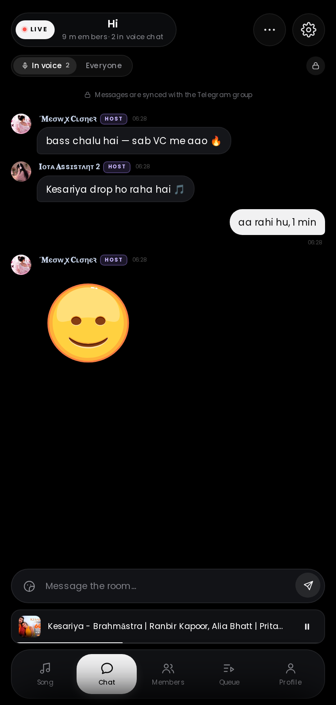
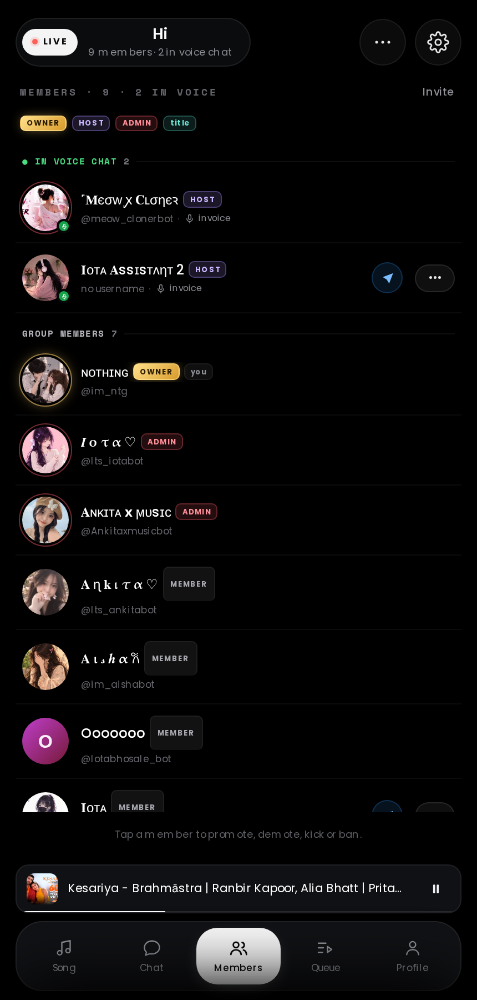
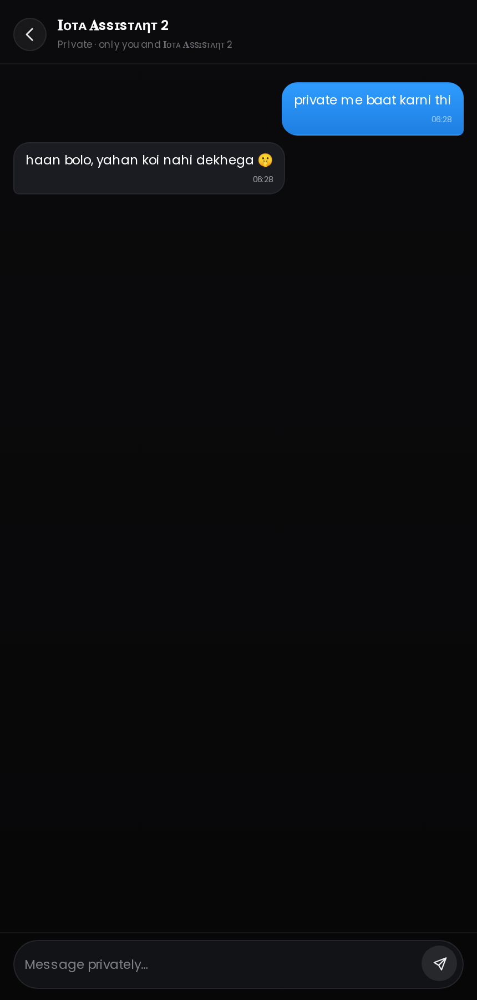
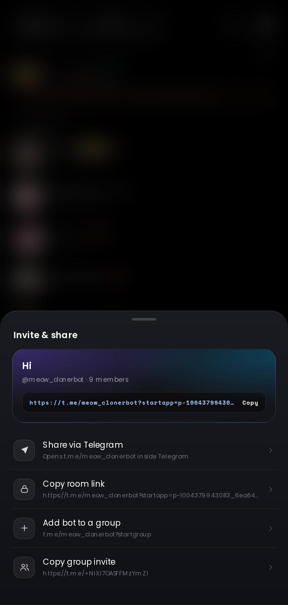
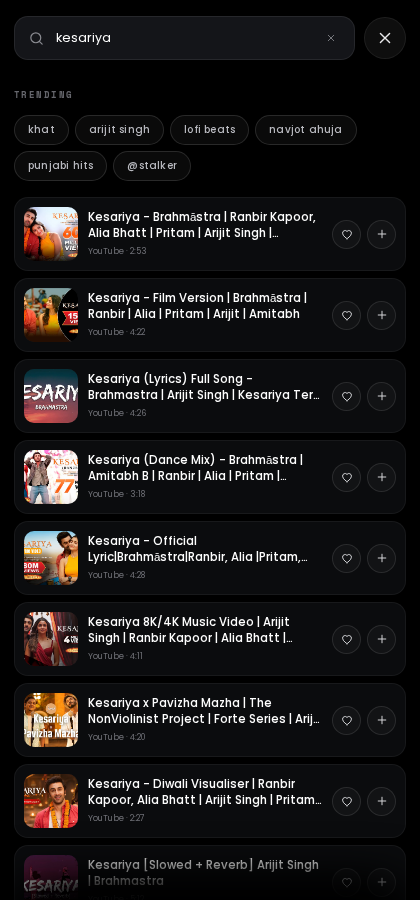
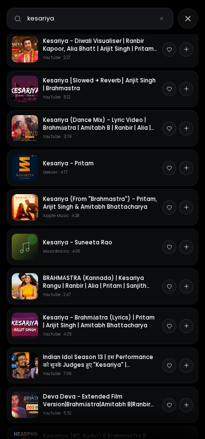
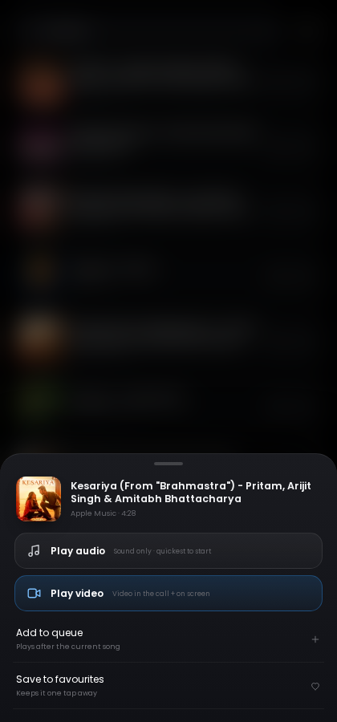
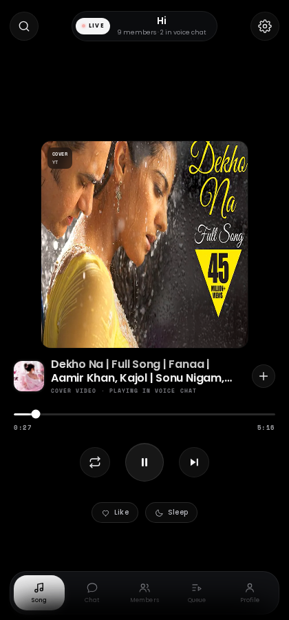

# Parvati Music — Mini App

The Telegram Mini App for **ParvatiMusic**: the room's now-playing screen, live
queue, room chat with real Telegram stickers, member moderation, private chats
and listening stats — all driven by the bot's real `RoomState`, not a mock.

Five tabs, one dark surface, glass dock: **Song · Chat · Members · Queue · Profile**.

* **In voice / Everyone** switch in Chat — the room chat only shows the members
  who joined the call.
* **Members** — `In voice chat` first, then `Group members`, each with an invite
  button.
* **Invite & share** — links always include the bot's @username, opened through
  `t.me/share/url`.
* **Private chats** — lock icon in the Chat header; stored separately, never
  mirrored to Telegram.
* **Stickers** — static WebP, video WebM (`<video>`) and animated `.tgs`
  (gunzipped in the browser and played with the vendored lottie-web).

<p align="center">
  
  
  
  
  
</p>

```
miniapp/
├── index.html            markup + inline SVG icon sprite
├── assets/
│   ├── css/app.css       design system (tokens, shell, views, sheets)
│   ├── js/app.js         state store, renderers, API client, SSE
│   ├── img/              artwork + avatars
│   ├── stickers/         60 self-hosted Twemoji SVGs
│   ├── vendor/           lottie_light.min.js (animated .tgs stickers)
│   └── fonts/            Poppins + Space Mono (woff2, offline)
├── server.mjs            zero-dep dev server + proxy
└── README.md
```

---

## See it

A 26-second walkthrough of the real UI (search → play → seek → chat → stickers →
moderation → queue → profile): [`docs/reel.mp4`](docs/reel.mp4).

Search mixes YouTube with the Iota catalogue (Deezer / Apple Music /
MusicBrainz), and every row opens an audio-or-video picker:

<p>
  
  
  
  
</p>

## Run it

```bash
cd miniapp
node server.mjs            # → http://localhost:8787
```

That starts a **demo room** in memory (chingu gang · 2 in room · 1 online) with
a live playback ticker, working search, queue, chat and moderation, so the whole
UI is explorable without Telegram.

```bash
node server.mjs --port 8080
node server.mjs --proxy http://127.0.0.1:8080   # talk to a running bot
```

---

## Real people, real roles

The Chat and Members tabs are driven by the live Telegram group, not by a mock:

* **Names and profile photos** come from the Bot API (`getChatMember`,
  `getUserProfilePhotos`), proxied and cached by the app so avatars render
  instantly and never leak the bot token to the browser.
* **The full roster** comes from the assistant's MTProto session
  (`channels.getParticipants`) — the Bot API only exposes administrators. Roles
  are resolved per member afterwards, so a 200-person group lists everyone.
* **Role tags**, each with its own colour:

  | Tag | Who | Look |
  | --- | --- | --- |
  | `OWNER` | group creator | gold gradient, gold avatar ring |
  | `HOST` | the bot/assistant sitting in the voice chat | violet, violet ring |
  | `ADMIN` | administrators | red |
  | `title` | custom admin title | teal |
  | `MEMBER` | everyone else | grey |

* **Chat** mirrors every message in the group — text with bold/italic/code/
  spoiler/link entities, replies, photos, voice notes and stickers — with the
  sender's avatar and tags. Messages typed in the app are sent through the Bot
  API, so they land in the real group.
* **Stickers** are real: the panel loads sticker sets straight from Telegram
  (`getStickerSet`) and sends by `file_id`.
* **Premium emoji**: custom-emoji packs are listed and sent as
  `custom_emoji` entities; mirrored messages resolve their document ids through
  `/api/emoji/<id>` so everyone sees the animated glyph.

---

## Ending a session

`/end` (or the red **End** button in the app's settings sheet) closes the whole
session, not just playback:

1. the stream stops and the assistant **leaves the Telegram group call** —
   when it was the last participant the voice chat closes for everyone;
2. every member's "in voice" flag drops to false, the header switches from
   `LIVE` to `ENDED` and the roster shows `0 in voice`;
3. the mirrored chat is **cleared**;
4. a summary is kept and rendered on the Song tab: who ended it, at what time,
   how long the call ran, how many tracks played and the last track.

`/stop` and the stop button on the player card take the same path. If the queue
simply runs out the session closes too, but the chat is left alone (nothing was
explicitly ended). Sending `/play` again flips `LIVE` back on and starts a fresh
summary.

---

## Connect it to the bot

The bot ships `bot/src/webapp.rs`: a dependency-free HTTP + SSE server that
serves this folder and exposes the room over JSON. It is already wired in
`bot/src/main.rs`:

```rust
parvati_bot::webapp::install(rooms.clone());
```

Configure it in `bot/.env`:

```ini
MINIAPP_PORT=8080            # must differ from PORT (health server)
MINIAPP_CHAT_ID=-1001234567890   # the voice chat the app controls
MINIAPP_ROOM_TITLE=chingu gang
MINIAPP_ME_NAME=your name
MINIAPP_ME_USERNAME=your_username
MINIAPP_DIR=miniapp          # path to this folder, relative to the binary cwd
```

Rebuild and run the bot, then open `http://<vps>:8080/`. The app reads the same
`Rooms` map the chat commands use, so a song started with `/play` in Telegram
appears in the app instantly and vice-versa.

### Point Telegram at it

1. `@BotFather` → `/mybots` → your bot → **Bot Settings → Menu Button** (or
   **Configure Mini App**) → set the URL to `https://<your-domain>/`.
2. HTTPS is required by Telegram — put Caddy/nginx in front of `MINIAPP_PORT`.
3. `server.mjs` is only needed for local development; in production the Rust
   server serves the same files.

---

## API

| Method | Path | Body | Effect |
| --- | --- | --- | --- |
| GET | `/api/state` | — | full snapshot (room, playback, roster, chat) |
| GET | `/api/events` | — | SSE, snapshot every 1.5 s |
| GET | `/api/search?q=` | — | `registry::search_tracks` |
| POST | `/api/play` | `{id, kind}` or `{query, kind}` | `kind: "audio"` (m4a) or `"video"` (mp4) → download → start |
| GET | `/api/media?id=&kind=` | — | the file being played, with `Range` support (video player) |
| POST | `/api/toggle` | `{}` | pause / resume |
| POST | `/api/skip` | `{}` | next track |
| POST | `/api/seek` | `{position}` | absolute seek + engine restart |
| POST | `/api/loop` | `{mode: 0\|1\|2}` | off / queue / one |
| POST | `/api/mute` | `{muted}` | engine mute |
| POST | `/api/queue/add` | `{id, kind}` | append (idempotent, creates the room; `kind` carries audio/video) |
| POST | `/api/queue/remove` | `{index}` | remove one |
| POST | `/api/queue/move` | `{from, to}` | reorder |
| POST | `/api/queue/clear` | `{}` | clear |
| POST | `/api/fav` | `{id, on?}` | toggle a favourite |
| POST | `/api/sleep` | `{minutes}` | sleep timer (0 = off) |
| POST | `/api/chat` | `{text, kind, replyTo}` | post to room chat |
| POST | `/api/chat/send` | `{kind, text, sticker, entities, replyTo, local}` | send to the real group (`local:true` = preview only) |
| POST | `/api/chat/react` | `{mid, emoji}` | react to a message |
| POST | `/api/session/end` | `{id, name}` | end the call: stop, leave, clear chat, summarise |
| GET | `/api/avatar/<uid>` | — | profile photo (cached) |
| GET | `/api/tgimg?fid=` | — | any Telegram file thumbnail |
| GET | `/api/emoji/<id>` | — | premium emoji document |
| GET | `/api/stickers?set=` | — | sticker / custom-emoji pack |
| POST | `/api/members` | `{id, action}` | promote / kick / ban |
| POST | `/api/settings` | `{autoplay, ...}` | room settings |
| GET | `/api/dm?me=&peer=` | — | private threads / one thread |
| POST | `/api/dm/send` | `{me, to, text}` | private message (never mirrored) |

Snapshot shape:

```json
{
  "room":     { "id": -1001, "title": "chingu gang", "members": 2, "online": 1, "live": true,
                "vc_ids": ["42"], "vc_known": true,
                "bot": "meow_clonerbot", "app_link": "https://t.me/<bot>?startapp=…",
                "share": "https://t.me/share/url?url=…&text=Join%20my%20music%20room" },
  "session":  { "live": true, "started_at": 1762, "duration": 52, "ended_at": 0,
                "ended_by": "", "tracks": 0, "cleared": false },
  "me":       { "id": "42", "name": "…", "username": "…", "photo": "", "level": 4, "levelPct": 62 },
  "quote":    "I can't hate anyone, I just know where not to return.",
  "playback": { "track": { "id": "…", "title": "…", "duration": 297, "art": "…", "requester": "…" },
                "position": 43, "paused": false, "loop": 0, "shuffle": false, "queue": [],
                "liked": true, "pending": null, "error": "" },
  "members":  [ { "id": "42", "name": "…", "role": "owner", "vc": true, "me": true } ],
  "messages": [ { "id": "m1", "kind": "text", "text": "YO", "ts": "16:32", "mine": true } ],
  "recent":   [ { "id": "…", "title": "…" } ],
  "favorites":[ { "id": "…", "title": "…" } ],
  "sleep":    0,
  "settings": { "autoplay": true }
}
```

The client degrades gracefully: missing artwork or avatars are replaced by
generated gradient covers/initials, and if the API is unreachable the UI falls
back to an offline demo room.

---

## Design notes

* **Type**: Poppins for UI, Space Mono for the mono labels (`NO SONG PLAYING`,
  `ADDED BY · …`, timestamps, durations).
* **Surface**: near-black `#000` with `rgba(255,255,255,.05–.09)` glass layers,
  1px hairlines at 7% white, one accent blue `#2f9bff`.
* **Motion**: 320 ms view slide, 380 ms search overlay, springy `scale(.92)` on
  every control, equalizer bars on the queue's now-playing row, live dot pulse.
* **Desktop**: renders inside the phone mock-up from the product reel; below
  520 px it goes edge-to-edge for a real Telegram webview.
* **Cheap by default**: renders are coalesced per animation frame, hidden tabs
  skip painting, and Profile → *Lite mode* (auto-on for ≤4 GB / ≤4 core
  devices) swaps every `backdrop-filter` for a solid panel.
